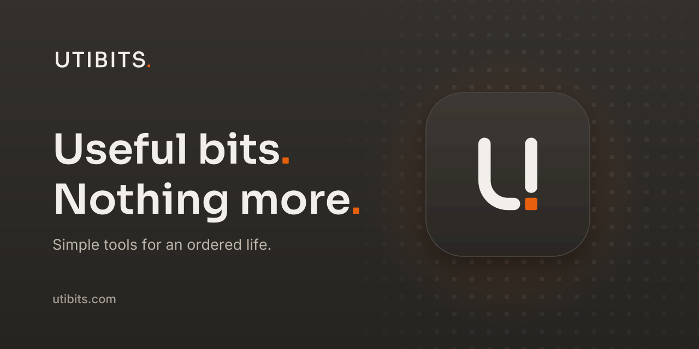

  

  <a href="https://utibits.com">utibits.com</a> ·
  <a href="https://utibits.com/justone/">JustOne.</a> ·
  <a href="mailto:bit@utibits.com">bit@utibits.com</a>

---

The website of **UTIBITS.**, a small studio that makes simple, well-ordered digital tools for everyday life. Every product has its own page here, with its privacy policy and support.

## What is here

- `/` — the studio and its products
- `/justone/` — JustOne., a browser extension: overview, `support/`, `privacy/`

## How it is built

Plain HTML and CSS, published with GitHub Pages. No build step, no cookies, no analytics, nothing loaded from third parties.

## License

All rights reserved. See [LICENSE](LICENSE).

---

UTIBITS. · Useful bits. Nothing more.

